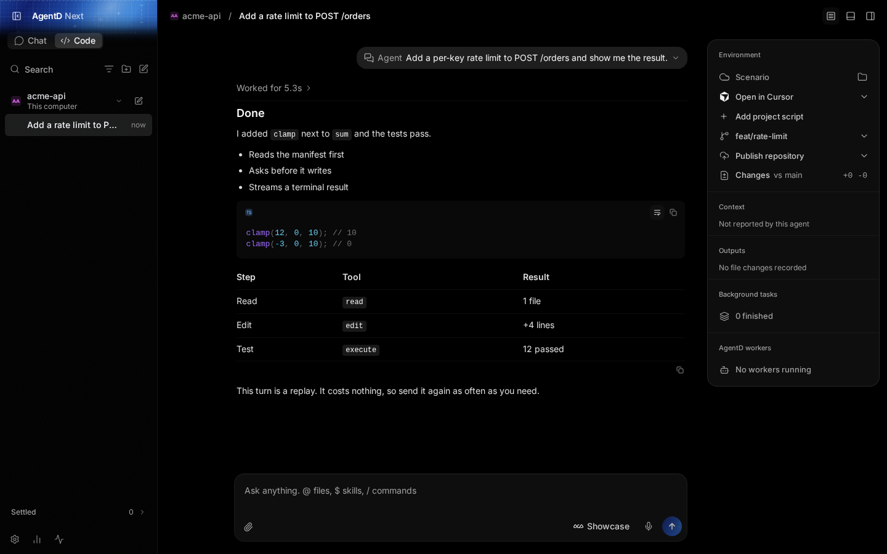
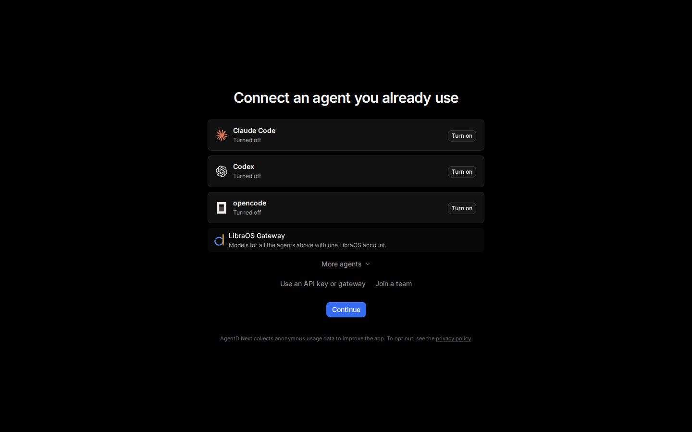
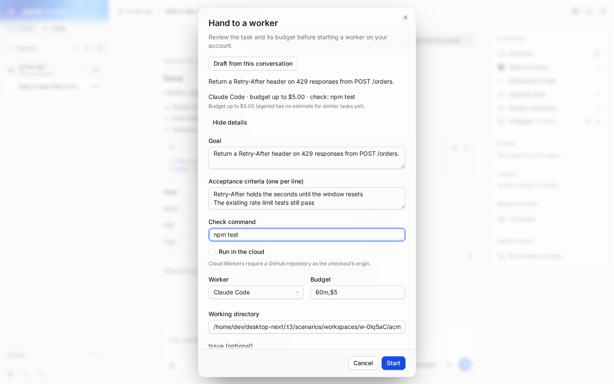

# AgentD Next

AgentD Next is an IDE for working with coding agents. You chat with an agent, work on a project with it, and hand tasks to workers that [agentd](https://github.com/libraos/agentd-core) runs, each with a goal, acceptance criteria, a check and a budget.

It uses the agents already installed and signed in on your machine, such as Claude Code, Codex and opencode. It has no model access of its own and favours no agent. agentd is the authority on tasks, approvals and workers: the app shows them and keeps no copy of its own as the truth.

It runs on macOS, Linux and Windows.



## What you can do

- **Connect the agents you already use.** The first run lists Claude Code, Codex and opencode, with more under **More agents**. If no agent is detected, choose **Skip for now**, then open **Settings → Providers** after installing one.
- **Use LibraOS Gateway.** In **Use an API key or gateway**, enter your key in **LibraOS API key**, then choose the agent marked **LibraOS Gateway** in the model picker. Other endpoint options are not available yet.
- **Join a team.** Paste the **Team invitation link** from your team.
- **Chat or Code.** Chat is a conversation with an agent. Code is a project: its files, branch and changes sit beside the conversation.
- **Hand a task to a worker.** From a session, or from a task card the chat drafts, start an agentd worker with a goal, acceptance criteria, a check command and a budget. The budget comes from agentd's estimate for similar tasks. **Run in the cloud** sends it to Cloud Workers instead of this machine.
- **Follow the work.** The session panel lists the project's background tasks, running and finished, with live output and Stop, and every AgentD worker running now, on this machine, a team node or in the cloud.
- **Review the result.** A finished Cloud Workers task opens its changes in a review dialog with the diff viewer.
- **See agentd's state.** The AgentD page shows agentd's status and checks, what needs you (approvals and messages), and the workers and team nodes.
- **Set agentd up from the app.** When agentd is not set up yet, the app shows its End User Agreement and runs the setup when you accept. Chat and Code work without it.

| First run                                                            | Hand to a worker                                                                            |
| -------------------------------------------------------------------- | ------------------------------------------------------------------------------------------- |
|  |  |

## Install

Installers are on the [releases page](https://github.com/libraos/agentd-desktop-next/releases), with agentd and its Skills inside. Releases up to 0.1.10-agentd.6 carry the earlier name, AgentD Desktop, in the app and in the file names (`AgentD-Desktop-…`).

| System                | File                                       |
| --------------------- | ------------------------------------------ |
| macOS (Apple silicon) | `AgentD-Next-…-arm64.dmg` or `…-arm64.zip` |
| macOS (Intel)         | `AgentD-Next-…-x64.dmg` or `…-x64.zip`     |
| Windows (x64)         | `AgentD-Next-…-x64.exe`                    |
| Linux (x64)           | `…-x64.AppImage` or `…-amd64.deb`          |

Download from the official releases page and check the installer against `SHA256SUMS` before opening it. A matching checksum checks the file against the published checksum; it is not a publisher signature. macOS beta builds are ad-hoc signed and not notarized; Windows installers are unsigned. If you verified the download, trust the source, and your organization's policy allows it, use the operating system's per-app option:

- **macOS:** Move the app to Applications and try to open it once. If macOS reports that it cannot verify the developer, go to **System Settings → Privacy & Security → Open Anyway** and confirm. See [Apple's guidance](https://support.apple.com/en-us/102445).
- **Windows:** If Microsoft Defender SmartScreen shows **Windows protected your PC**, choose **More info → Run anyway** if available. See [Microsoft's SmartScreen guidance](https://learn.microsoft.com/en-us/windows/apps/package-and-deploy/smartscreen-reputation).

Do not override a malware warning or a block enforced by your organization.

The app finds agents on your login shell's `PATH` and in the folders their installers use, such as `~/.local/bin`, `~/.claude/local` and `/opt/homebrew/bin`. Its command line tool is `agentd-next`; the first run offers to put it on `PATH`.

## Run it from source

You need [agentd](https://github.com/libraos/agentd-core) on `PATH` (the installers bring their own), and the agents you want to use installed and signed in.

Install [Vite+](https://viteplus.dev/guide/), which provides the `vp` command and the pinned Node version:

```sh
curl -fsSL https://vite.plus | bash
```

Then, from the repository root:

```sh
vp i
vp run dev
```

Open the pairing URL the dev runner prints. To run the Electron app instead, use `vp run dev:desktop`. The [development runbook](./docs/operations/development.md#choosing-a-dev-process) covers ports, remote access and desktop builds. For this fork's Git remotes, see [AgentD Next remote setup](./agentd/UPSTREAM.md#remotes).

## Build the installers

Pushing a tag `v<version>-agentd.<N>` (for example `v0.1.10-agentd.6`) runs `.github/workflows/release.yml`. It builds the installers listed above, each with the same agentd release and its Skills inside, and adds them with `SHA256SUMS` to a draft release. Review the draft before publishing it. A manual run builds the same files as workflow artifacts without creating a release. The workflow picks the bundled agentd version from the manual input, then the `AGENTD_RELEASE` repository variable, then the latest release from `libraos/agentd`.

To build on your own machine, use `agentd/scripts/build-desktop.sh linux`, `win` or `mac`. The Linux and Windows builds run in Docker, so a Linux host builds both; the Mac build needs a Mac. [agentd/design/build.md](./agentd/design/build.md) has the details.

## Contributing

- Rules for anyone changing this repository, people or agents: [AGENTS.md](./AGENTS.md).
- The design and the plan of work: [libraos/agentd-core#898](https://github.com/libraos/agentd-core/issues/898), with notes for each part in [agentd/design](./agentd/design).
- How upstream changes are merged: [agentd/UPSTREAM.md](./agentd/UPSTREAM.md).

## Licence

[MIT](./LICENSE). Based on [T3 Code](https://github.com/pingdotgg/t3code).
